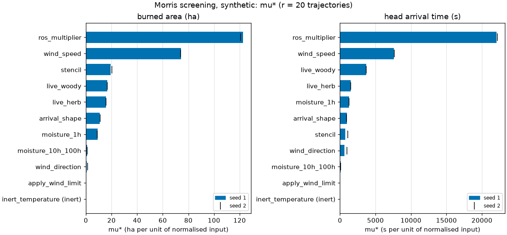
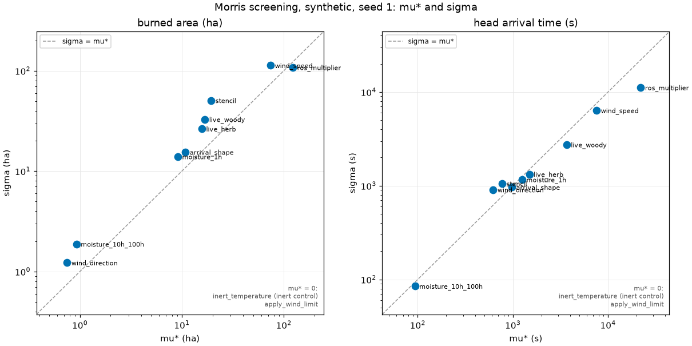
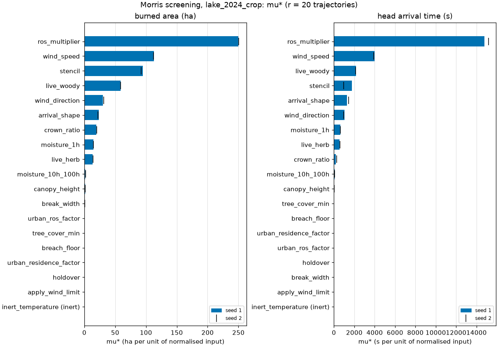
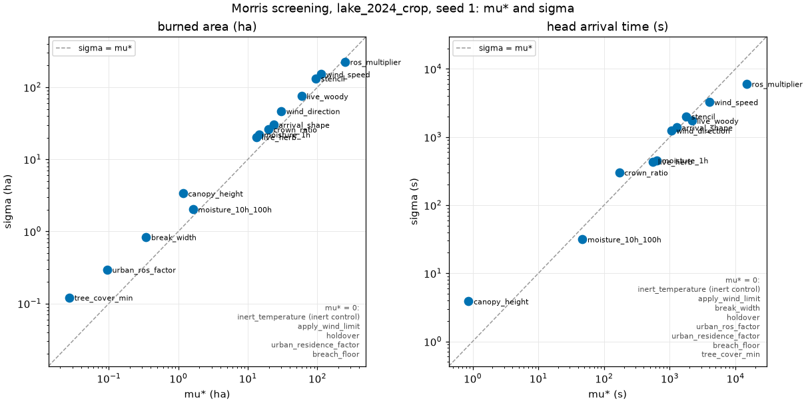

# Sensitivity analysis (WP 3.2)

Which inputs drive the simulated burned area and the time the head takes to travel a given
distance, and therefore where data quality matters (`docs/plan.md` section 7). A Morris
screening over wind speed and direction, four fuel moistures, the rate-of-spread multiplier,
the kernel shape, the stencil, the placeholders of section 13 that can be varied without
touching the engine, and one deliberately inert control.

Everything here is regenerated by one command (about 3 minutes with 8 worker processes and the
Numba engine on the 8-thread development laptop; 3 min 2 s wall clock for the committed
files):

```sh
uv run python scripts/sensitivity.py --workers 8      # CSVs and figures in docs/img/sensitivity/
```

The study is defined in `configs/sensitivity.yaml` (inputs, ranges with their sources, scenarios,
seeds); the method is `wildfire_sim.sensitivity`. The same seeds give the same CSVs: repeated
runs of the script reproduced the CSVs byte for byte. Units: areas in ha, times in s;
the Morris statistics are in output units per unit of the normalised input (below).

## Summary

- **The rate-of-spread multiplier ranks first on both outputs in both scenarios,** then wind
  speed. Over its calibration range [0.3, 3] the multiplier alone moves the head arrival time
  by hours (`mu*` = 14,780 s on the fire A crop, seed 1). Calibrating it (WP 3.1) is the most
  valuable single step; the 10 m wind speed is the most valuable input datum.
- **The stencil is the third input for burned area in both scenarios** (8 neighbours burn more
  in the window than 16, nearly every elementary effect of the same sign), ahead of every
  fuel moisture. Its `mu*` is 1.5 times the plain 8-against-16 difference (section 1): by that
  difference (63 ha on the crop, 13 ha synthetic, seed 1) it stays third on the crop but falls
  to fifth on the synthetic grid, below both live moistures. This is a model-structure choice,
  not a datum: a result that depends on it should state which stencil it used. The kernel shape matters less but is not negligible
  (rank 6 on area), even though each shape runs with its measured front-speed correction.
- **Live woody moisture is the most influential moisture** (rank 3-4), above live herbaceous and
  1-h moisture, in both scenarios. Live moisture is a placeholder (Scott & Burgan scenario L1
  by month, section 13), so the NFMD samples are worth fetching. Over the ranges screened the
  1-h moisture matters less, partly because both scenarios are very dry; 10-h/100-h moisture
  ranks near the bottom.
- **Wind direction** barely matters on flat uniform fuel (rank 7-9: on a flat uniform grid it
  can only act through the lattice's orientation, so this is the residual anisotropy of the
  fitted rates, small) but ranks 5-6 on the crop, where it decides which fuels and slopes the
  head runs into.
- **Section 13 placeholders.** Crown ratio matters on the crop (rank 7 on area, ahead of 1-h
  moisture): it decides which cells count as sheltered in the wind adjustment factor, so the
  per-cell LANDFIRE canopy layers are worth carrying. Canopy height, break width, the urban
  rate factor and the breaks' tree threshold have small effects in a 45-minute window;
  holdover, the urban residence factor, the breach floor and Rothermel's wind limit have none in
  this design (section 6).
- **Acceptance.** The inert control (an offset on the air temperature, which no part of the
  engine reads) has `mu* = 0` and `sigma = 0` exactly on both outputs in both scenarios and
  both seeds, and ranks last. Inputs the scenarios never exercise tie with it at 0 (section 6).
- **Edge.** No run of either scenario reached the grid edge within its window, so no burned
  area is a lower bound (section 5). Every run reached the head distance, so every elementary
  effect is defined.
- **Seeds.** Repeating the screening with a second kernel seed leaves the ranking of the
  leading inputs unchanged; ranks of inputs with close `mu*` swap (section 5).

## 1. Method

The elementary-effects method of Morris (1991) with the `mu*` statistic of Campolongo,
Cariboni & Saltelli (2007), implemented in NumPy (`wildfire_sim.sensitivity`, no extra
dependency; unit-tested on analytic functions with known answers in
`tests/test_sensitivity.py`).

- Each of the `k` inputs is mapped to [0, 1] and the interval cut into `p = 4` levels
  {0, 1/3, 2/3, 1}. A *trajectory* is `k + 1` points: a random base point, then `k` steps, each
  changing one input, every input exactly once, by `+-delta` with `delta = p / (2 (p - 1)) =
  2/3`. Points are built from Morris's orientation matrix
  `B* = (J x* + (delta / 2) [(2B - J) D* + J]) P*` (random base `x*`, random signs `D*`,
  random order `P*`), exactly on the grid.
- The step along input `i` gives one elementary effect
  `EE_i = (y(x + delta e_i) - y(x)) / delta`. With `r = 20` trajectories there are 20 effects
  per input and `r (k + 1)` runs per scenario and seed (240 synthetic, 400 on the crop).
- Statistics per input: `mu` (mean effect, signed), `mu*` (mean absolute effect, which does not
  let effects of opposite sign cancel) and `sigma` (standard deviation, `ddof = 1`). A large
  `mu*` marks an influential input; `sigma` comparable to `mu*` marks an effect that depends on
  where it is taken (nonlinearity or interaction with other inputs). Inputs are ranked by
  `mu*`; equal values share a rank.
- **Ranges are on the input's own scale:** linear, except the multiplier, which is
  log-uniform. Because every input spans [0, 1] after mapping, `mu*` compares inputs *over the
  ranges chosen*: a wider range makes an input look more important. The ranges are part of the
  result (section 4).
- **Discrete inputs.** An input with `L` listed values takes value `floor(j L / (p - 1))` (capped
  at `L - 1`) at grid index `j`, so [0, 1] is cut into `L` equal bins. Since `delta = 2/3`
  exceeds every bin width, every step changes a discrete input to another value: the stencil
  (`L = 2`) always switches between 8 and 16, the kernel shape (`L = 4`) between 5 and 50 or
  20 and 200. Its effect is that change divided by `delta`, the usual convention. For a
  two-level input this is 1.5 times the plain difference between its two values, whereas a
  continuous input's effect estimates the change over its whole range; the stencil's `mu*` is
  therefore 1.5 times the mean absolute difference between an 8- and a 16-neighbour run, and
  its rank is read with that in mind (summary).
- **Common random numbers.** All runs of a screening use one simulator seed, so two runs that
  differ in one input share their kernel thresholds and breach draws (except that changing the
  stencil or the kernel shape changes the thresholds themselves). An input the model does not
  read therefore has effects of exactly 0. The trajectories come from
  `numpy.random.default_rng(design_seed)`; the screening is repeated with seed 1 and seed 2.
- **Engine.** Numba when installed, else NumPy; the two agree to floating-point rounding. The
  committed files were made with Numba.

## 2. Outputs

For each run (`sensitivity.run_outputs`):

- **Burned area, ha:** cells ignited no later than `window_s` after the ignition (1 h synthetic,
  45 min on the crop). Counting from the run's arrival times is the same as stopping the run at
  the end of the window, because nothing after it changes earlier arrivals.
- **Head arrival time, s:** time after the ignition at which the fire first ignites a cell whose
  centre is at least `head_distance_m` from the ignition cell's centre (900 m synthetic, 1,200 m
  on the crop). The first cell to get that far is reached by the fastest part of the front, the
  head, in whatever direction it runs, so the output is defined for any wind direction. A fixed
  target cell would not be: a run whose head misses it has no arrival time.
- **Never reached.** Runs are long (18 h synthetic, 12 h after the ignition on the crop) so that
  slow fires get there. A run that still does not is given no value (NaN); the elementary
  effects that touch it are left out of the statistics and counted (`n_valid` in the CSVs),
  never filled in. In the committed study every run reached the head distance (`n_valid` = 20
  everywhere).
- **The grid edge.** The head distance is shorter than the distance from the ignition to the
  edge band of the 16-neighbour stencil (checked when the screening starts), and a fire reaches
  a cell that far before it reaches the band, so the head arrival time is never affected by the
  edge. The burned area can be: a run whose fire reaches the edge band within the window
  (`provenance["reached_edge_s"]`) is a lower bound, flagged per run (`edge_in_window` in the
  runs CSV) and counted per input (`n_edge`: elementary effects of the burned area that involve
  such a run).

## 3. Scenarios

- **Synthetic:** flat, uniform GS2 (Scott & Burgan 122, low-load dry-climate grass-shrub, which
  has live herbaceous and live woody fuel and cures dynamically) on 241 x 241 cells of 30 m,
  no canopy, no breaks; a steady 6 m/s wind from the west; 1-h, 10-h and 100-h moisture 4, 5 and
  6 %; Rothermel rule; ignition at the centre. A clean case: wind and fuel only.
- **Fire A crop (`lake_2024_crop`):** the committed 167 x 167-cell (5 km) crop of the 2024 Lake
  Fire grid (`tests/fixtures/lake_2024_5km.npz`) with its real LANDFIRE fuels, canopy, terrain,
  urban cells and road and stream breaks, and its hourly HRRR weather
  (`tests/fixtures/lake_2024_weather.yaml`); Rothermel rule; ignited at the crop's centre at the
  recorded ignition time (22:48 UTC on 5 July 2024, 56,880 s into the weather series).

Both use `dt_s = 60` and the defaults otherwise (16 neighbours and `arrival_shape` 200 when the
stencil and shape are not screened; the YAML values of `configs/rothermel.yaml`).

The two scenarios screen different input sets. Inputs that a scenario cannot exercise at all
are left out of it: the synthetic grid has no canopy, breaks or urban cells, so canopy height,
crown ratio, break width, the urban factor and the breach parameters would have effects of 0
there by construction.

## 4. Inputs

Every input is applied to the whole run: a factor or offset on every point of the weather
series (as the ensembles of WP 1.6 do; wind speed and direction go through
`ensemble.perturb_config`), a value for a fuel moisture, or a model setting. The sources are in
`configs/sensitivity.yaml`; most ranges are judgments and are labelled so.

| Input | What it changes | Range | Source |
| --- | --- | --- | --- |
| `wind_speed` | factor on the 10 m wind speed | 0.7-1.3 | judgment (no local verification of HRRR winds for these fires yet) |
| `wind_direction` | offset on the wind direction | -30 to +30 deg | judgment (a 4 km analysis does not resolve terrain-channelled wind) |
| `moisture_1h` | factor on 1-h dead moisture | 0.7-1.3 | judgment (fine fuel departs from the equilibrium model) |
| `moisture_10h_100h` | factor on 10-h and 100-h dead moisture together | 0.7-1.3 | judgment |
| `live_herb` | live herbaceous moisture | 0.30-0.60 | Scott & Burgan (2005) scenarios L1-L2 |
| `live_woody` | live woody moisture | 0.60-0.90 | Scott & Burgan (2005) scenarios L1-L2 |
| `ros_multiplier` | factor on every directional rate (`ensemble.ScaledRateRule`) | 0.3-3, log-uniform | WP 3.1 calibration bounds |
| `arrival_shape` | kernel gamma shape `k` | 5, 20, 50, 200 | the shapes with a measured front-speed correction (`configs/kernel_correction.yaml`) |
| `stencil` | neighbours | 8, 16 | the simulator's two stencils |
| `inert_temperature` | offset on the air temperature | -5 to +5 deg C | **inert control** (below) |
| `apply_wind_limit` | Rothermel's (1972) wind limit | off, on | open decision, section 13 |
| `canopy_height` | uniform canopy height for the wind adjustment factor | 5-25 m | judgment about the 15 m placeholder |
| `crown_ratio` | uniform crown ratio for the wind adjustment factor | 0.2-0.6 | judgment about the 0.4 placeholder |
| `break_width` | factor on every road and stream break width | 0.5-1.5 | judgment about the OSM class defaults |
| `holdover` | holdover time of every fuel model | 6-24 h | judgment about the 12 h placeholder |
| `urban_ros_factor` | urban rate-of-spread factor | 0.25-1.0 | judgment about the 0.5 placeholder |
| `urban_residence_factor` | urban residence-time factor | 10-60 | judgment about the 30 placeholder |
| `breach_floor` | minimum intensity of the breach model | 0.09-0.36 MW/m | half to twice the 0.18 MW/m placeholder |
| `tree_cover_min` | canopy cover above which trees stand near a break | 0.05-0.30 | judgment about the 0.10 placeholder |

**Live moisture: herbaceous and woody separately.** They act through different mechanisms
(herbaceous moisture sets how much of a dynamic fuel model's herbaceous load has cured; woody
moisture damps the live fuel of shrubs) and dominate different fuels of fire A (grass and
grass-shrub, against shrub), and both come from the same placeholder month mapping. Screening
them separately says which one the NFMD samples matter for.

**The inert control** is an offset on `temperature_c` of every weather point. Fuel moistures
are computed from temperature and humidity before a run (`data.weather`); during a run neither
the engine nor any spread rule reads `Weather.temperature_c` (`grid.Weather` documents it as
informational). Its elementary effects must therefore be exactly 0, which tests the whole chain
from input to output, common random numbers included, for spurious effects.

**How the placeholders are reached.** Spread-rule settings through `spread.params` (the
`RothermelRule` keyword arguments); break widths by scaling `Grid.break_width_m` of the grid
passed to `sim.run`; holdover, urban and breach values by editing a temporary copy of
`configs/` selected with `WILDFIRE_SIM_CONFIGS`, the override `config.configs_dir` documents
(`sensitivity.parameter_files`). No engine code is changed.

## 5. Results

`mu*` and `sigma` per input, seeds 1 and 2; the full tables with `mu` and the counts are the
`*_indices.csv` files, every run is in the `*_runs.csv` files.

### Synthetic





Burned area (ha), window 1 h:

| input | mu* (seed 1) | sigma (seed 1) | rank (seed 1) | mu* (seed 2) | sigma (seed 2) | rank (seed 2) |
| --- | --- | --- | --- | --- | --- | --- |
| ros_multiplier | 122.7 | 108 | 1 | 120.6 | 106.8 | 1 |
| wind_speed | 74.18 | 113 | 2 | 73.87 | 112.3 | 2 |
| stencil | 19.39 | 50.67 | 3 | 20.18 | 51.38 | 3 |
| live_woody | 16.81 | 32.83 | 4 | 16.67 | 32.29 | 4 |
| live_herb | 15.71 | 26.39 | 5 | 15.73 | 26.59 | 5 |
| arrival_shape | 10.85 | 15.49 | 6 | 11.27 | 18.06 | 6 |
| moisture_1h | 9.126 | 13.96 | 7 | 8.95 | 14.32 | 7 |
| moisture_10h_100h | 0.9247 | 1.881 | 8 | 0.9113 | 1.972 | 9 |
| wind_direction | 0.7492 | 1.225 | 9 | 1.262 | 1.818 | 8 |
| inert_temperature | 0 | 0 | 10 | 0 | 0 | 10 |
| apply_wind_limit | 0 | 0 | 10 | 0 | 0 | 10 |

Head arrival time (s) at 900 m:

| input | mu* (seed 1) | sigma (seed 1) | rank (seed 1) | mu* (seed 2) | sigma (seed 2) | rank (seed 2) |
| --- | --- | --- | --- | --- | --- | --- |
| ros_multiplier | 2.208e+04 | 1.117e+04 | 1 | 2.215e+04 | 1.113e+04 | 1 |
| wind_speed | 7582 | 6370 | 2 | 7660 | 6476 | 2 |
| live_woody | 3672 | 2745 | 3 | 3688 | 2716 | 3 |
| live_herb | 1490 | 1328 | 4 | 1502 | 1335 | 4 |
| moisture_1h | 1251 | 1164 | 5 | 1254 | 1171 | 5 |
| arrival_shape | 975.4 | 964.9 | 6 | 931.8 | 1452 | 8 |
| stencil | 769.9 | 1056 | 7 | 1110 | 1421 | 6 |
| wind_direction | 621.4 | 907.3 | 8 | 971.2 | 1470 | 7 |
| moisture_10h_100h | 93.78 | 84.82 | 9 | 92.56 | 82.89 | 9 |
| inert_temperature | 0 | 0 | 10 | 0 | 0 | 10 |
| apply_wind_limit | 0 | 0 | 10 | 0 | 0 | 10 |

No run reached the grid edge within the window; every run reached 900 m (480 runs, both seeds).

### Fire A crop





Burned area (ha), window 45 min:

| input | mu* (seed 1) | sigma (seed 1) | rank (seed 1) | mu* (seed 2) | sigma (seed 2) | rank (seed 2) |
| --- | --- | --- | --- | --- | --- | --- |
| ros_multiplier | 249.8 | 224.7 | 1 | 250.6 | 223.4 | 1 |
| wind_speed | 112.9 | 151.3 | 2 | 112 | 148 | 2 |
| stencil | 94.84 | 132.6 | 3 | 91.86 | 126.4 | 3 |
| live_woody | 59.06 | 75.02 | 4 | 59.06 | 76.35 | 4 |
| wind_direction | 30.13 | 46.6 | 5 | 31.35 | 49.49 | 5 |
| arrival_shape | 23.33 | 30.16 | 6 | 22.15 | 29.75 | 6 |
| crown_ratio | 19.65 | 25.99 | 7 | 20.24 | 26.31 | 7 |
| moisture_1h | 14.4 | 22.09 | 8 | 14.71 | 23.07 | 8 |
| live_herb | 13.36 | 20.4 | 9 | 14.2 | 21.83 | 9 |
| moisture_10h_100h | 1.62 | 2.023 | 10 | 1.715 | 2.411 | 10 |
| canopy_height | 1.168 | 3.36 | 11 | 1.066 | 3.117 | 11 |
| break_width | 0.3442 | 0.8327 | 12 | 0.7695 | 3.036 | 12 |
| urban_ros_factor | 0.0945 | 0.2941 | 13 | 0.081 | 0.2493 | 13 |
| tree_cover_min | 0.027 | 0.1207 | 14 | 0.00675 | 0.03019 | 14 |
| inert_temperature | 0 | 0 | 15 | 0 | 0 | 15 |
| apply_wind_limit | 0 | 0 | 15 | 0 | 0 | 15 |
| holdover | 0 | 0 | 15 | 0 | 0 | 15 |
| urban_residence_factor | 0 | 0 | 15 | 0 | 0 | 15 |
| breach_floor | 0 | 0 | 15 | 0 | 0 | 15 |

Head arrival time (s) at 1,200 m:

| input | mu* (seed 1) | sigma (seed 1) | rank (seed 1) | mu* (seed 2) | sigma (seed 2) | rank (seed 2) |
| --- | --- | --- | --- | --- | --- | --- |
| ros_multiplier | 1.478e+04 | 6032 | 1 | 1.517e+04 | 6732 | 1 |
| wind_speed | 3977 | 3258 | 2 | 3916 | 3249 | 2 |
| live_woody | 2170 | 1735 | 3 | 2112 | 1554 | 3 |
| stencil | 1775 | 2011 | 4 | 955.8 | 910.6 | 5 |
| arrival_shape | 1269 | 1382 | 5 | 1430 | 1234 | 4 |
| wind_direction | 1053 | 1245 | 6 | 947.1 | 1356 | 6 |
| moisture_1h | 634.8 | 455.6 | 7 | 612.8 | 359.4 | 7 |
| live_herb | 553.2 | 435.5 | 8 | 579.5 | 390.7 | 8 |
| crown_ratio | 170 | 302.3 | 9 | 253.2 | 312.8 | 9 |
| moisture_10h_100h | 46.89 | 31.54 | 10 | 55.72 | 40.39 | 10 |
| canopy_height | 0.8669 | 3.877 | 11 | 6.145 | 23.75 | 11 |
| inert_temperature | 0 | 0 | 12 | 0 | 0 | 12 |
| apply_wind_limit | 0 | 0 | 12 | 0 | 0 | 12 |
| break_width | 0 | 0 | 12 | 0 | 0 | 12 |
| holdover | 0 | 0 | 12 | 0 | 0 | 12 |
| urban_ros_factor | 0 | 0 | 12 | 0 | 0 | 12 |
| urban_residence_factor | 0 | 0 | 12 | 0 | 0 | 12 |
| breach_floor | 0 | 0 | 12 | 0 | 0 | 12 |
| tree_cover_min | 0 | 0 | 12 | 0 | 0 | 12 |

**Edge.** No run of either seed reached the grid's edge band within the 45-minute window
(`n_edge` = 0 everywhere), so every burned area is a full value; 45 minutes was chosen with
exploratory runs of the script: a longer window lets the fastest corners of the design (largest
multiplier and wind, driest fuel) reach the edge of the 5 km crop, a shorter one leaves the
breaks and the town out of reach of every fire. Every run reached 1,200 m.

**Seeds.** The two seeds give the same top two inputs on every output and scenario and the same
ranks for most inputs. Ranks swap between inputs whose `mu*` are close: `stencil` and
`arrival_shape` on the crop's head arrival time; `arrival_shape`, `stencil` and `wind_direction`
on the synthetic head arrival time; `moisture_10h_100h` and `wind_direction` on the synthetic
area. The small break and tree effects are mostly seed noise: `break_width` is 0.3442 ha with
seed 1 and 0.7695 ha with seed 2, `tree_cover_min` 0.027 and 0.00675 ha.

## 6. Reading the results

**What drives burned area and head arrival.** The rate multiplier and the wind speed dominate,
with `sigma` close to `mu*` (or above it, for area): both act through the rate of spread, whose
effect on area is strongly nonlinear and interacts with every other input that changes the rate.
Calibrating the multiplier and checking the wind against stations are where effort pays most.
The signs are as physics expects (`mu` in the CSVs): wetter fuel burns less and arrives later;
more wind and a larger multiplier burn more and arrive sooner.

**The stencil and the kernel shape are part of the answer.** In both scenarios nearly every
elementary effect of the stencil has the same sign: 16 neighbours burn less area in the window and their
head arrives later than with 8. The screening does not say why; candidates are the different
lattice caps on the length-to-breadth ratio (1.4 on 8 neighbours, 2.1 on 16, so 8 neighbours
draw a wind-driven fire rounder and wider) and the different front-speed corrections (0.992 and
1.042 at shape 200). Larger kernel shapes burn more and arrive sooner, consistent with the known
weakness of the isotropic correction (`docs/plan.md` section 2.1: at low shape it leaves a
narrow head slow). Both say that the 16-neighbour stencil and shape 200 chosen after the lattice
study have to be kept fixed between calibration and prediction, and stated with every result.

**Moistures.** Live woody moisture ranks above every dead moisture; live herbaceous moisture
matters less because between L1 and L2 most of the herbaceous load stays cured. The 1-h moisture
matters less than one might expect over +-30 %: in these very dry scenarios a relative change is
a small absolute one. 10-h and 100-h moisture carry little load in grass and shrub models and
rank near the bottom.

**Placeholders that do not act here.** Effects of exactly 0 tie with the inert control and
share the last rank; each has a reason that is a property of the design, not evidence that the
parameter never matters:

- **Holdover** (6-24 h) can change a run only after a cell has been dormant at least 6 h; no
  fire in a 45-minute window, and none that stalled long enough before reaching 1,200 m.
- **Rothermel's wind limit** never changed an output. On the synthetic fuel it never binds at
  any corner of the ranges; on the crop it binds in isolated cells at some corners of the ranges
  over the run's hours, none of which decided an output here (checked by evaluating the rule
  outside the screening, not part of the script). The limit can matter in moister fuel on slopes
  (`docs/plan.md` section 13); these scenarios are dry.
- **Breach floor** (0.09-0.36 MW/m): no break decision within the window, or on the way to
  1,200 m, depended on where between these values the floor lies.
- **Urban residence factor** sets how long an urban cell flames. That enters spread only through
  a still-burning cell next to a break that is breached and turns back into fuel; it never did
  here.
- **Tree threshold, break width, urban rate factor** on the head arrival time: no break or urban
  cell decided the head's path to 1,200 m. On the area they act a little, within seed noise.

**Not screened.** Placeholders of section 13 left out, with the reason:

| Placeholder | Why not screened |
| --- | --- |
| Urban surrogate fuel model (TL3) | A categorical choice with no candidate set in the literature; `urban_ros_factor` scales the surrogate's spread instead. |
| Diurnal wind amplitude (0.85 m/s) | Used only to disaggregate daily gridMET wind; both fires now take hourly HRRR wind, which carries its own daily cycle. |
| NFMD sample window and radius | No NFMD sample has been fetched, so they select nothing; the live moistures they would set are screened directly. |
| Trunk roads as full barriers | A land-use classification of the grid, not a parameter of the run. |
| Live moisture month mapping | Screened through its result, the live moistures (L1 to L2). |
| 10-h moisture time lag | Not in the model. |
| Canopy layers per cell | Needs optional `Grid` layers (a frozen-module change); the uniform `canopy_height` and `crown_ratio` stand in. |

## 7. Limits

- **A screening, not a variance decomposition.** Morris ranks inputs by the size of their
  one-at-a-time effects averaged over the input space; it does not apportion the output
  variance (Sobol' indices would, at many times the cost), and `sigma` lumps nonlinearity and
  interaction together. With `r = 20`, inputs whose `mu*` are within about a factor 2 of each
  other are not reliably ordered: the stencil's `mu*` on the crop's head arrival time is 1,775 s
  with seed 1 and 956 s with seed 2.
- **Ranges are judgments.** Most ranges are not measured error statistics (section 4); a wider
  or narrower range moves an input up or down the ranking. The multiplier's range is the prior
  of the calibration, wide on purpose; after calibration its posterior range will be narrower
  and the next inputs will matter relatively more.
- **One-at-a-time steps on a 4-level grid.** Each effect is a finite difference over 2/3 of the
  range, so it measures large changes; local derivatives at the default values can differ.
- **Two scenarios, short windows.** A synthetic grass-shrub case and a 5 km crop of fire A over
  the first 45 minutes after ignition (head arrival at 1,200 m), not the full 815 x 978-cell fire
  A grid over days. Night-time behaviour (dormancy, the holdover time), the wind limit in moister
  fuel, and the breaks and the town farther from the ignition are not exercised; on the full
  grid and over the calibration window their ranks may differ. The crop's ignition is its
  centre at the recorded ignition time.
- **Edge.** No run reached the edge within its window here, but the 45-minute window on the
  crop was chosen for that; over a longer window the fastest runs would be lower bounds (the
  script counts and flags them).
- **Kernel noise.** Common random numbers remove noise from the comparison of runs that share
  their thresholds; changing the stencil or the kernel shape draws new thresholds, so those two
  inputs' effects include a realisation of kernel noise (small at shape 200, coefficient of
  variation 7 % per link, but not at shape 5).

## References

- Campolongo, F., Cariboni, J. & Saltelli, A. (2007). An effective screening design for
  sensitivity analysis of large models. Environ. Model. Softw. 22, 1509-1518.
- Morris, M. D. (1991). Factorial sampling plans for preliminary computational experiments.
  Technometrics 33, 161-174.
- Saltelli, A., Ratto, M., Andres, T., Campolongo, F., Cariboni, J., Gatelli, D., Saisana, M. &
  Tarantola, S. (2008). Global Sensitivity Analysis: The Primer. Wiley, chapter 3.
- Scott, J. H. & Burgan, R. E. (2005). Standard fire behavior fuel models. USDA For. Serv. Gen.
  Tech. Rep. RMRS-GTR-153.
