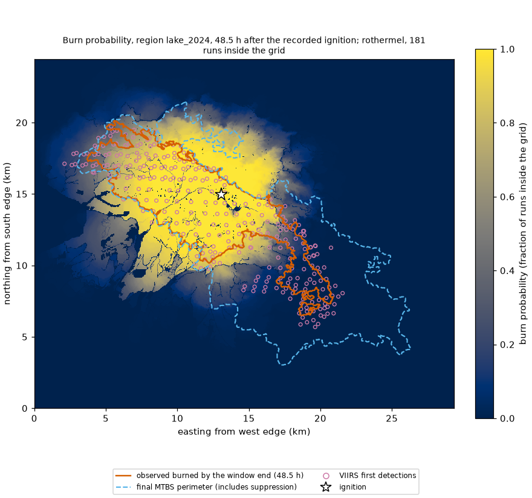
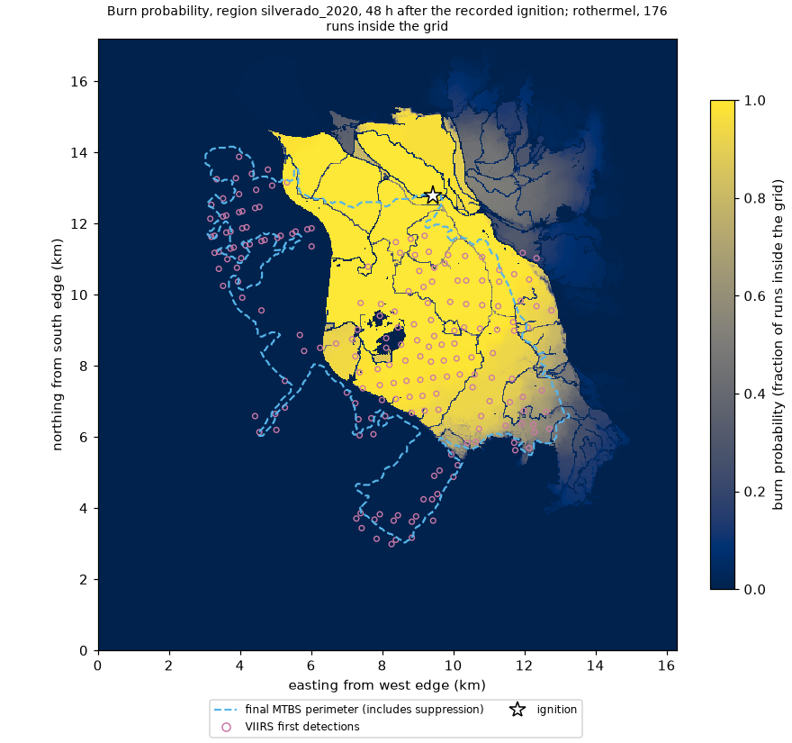
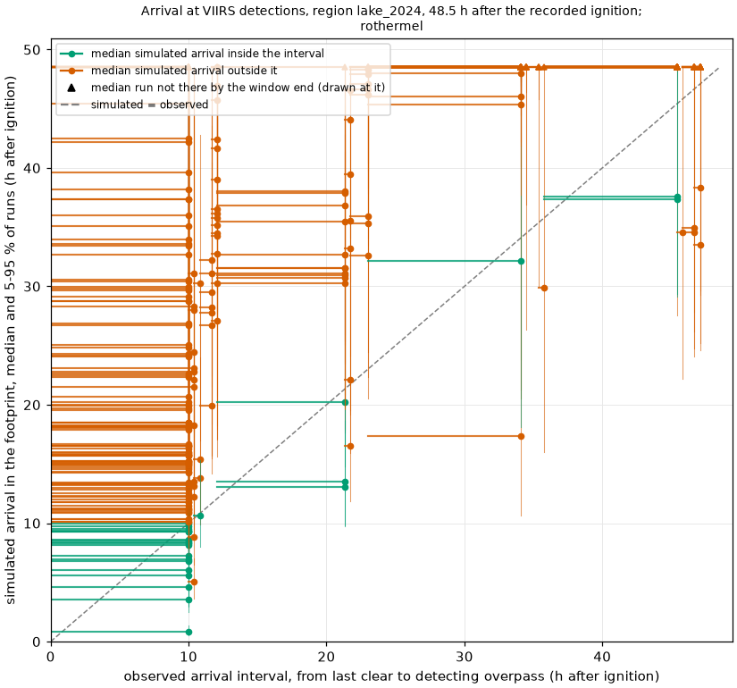

# Validation (WP 3.3)

How the calibrated model is tested against the two validation fires: which fires and why, what
the test can and cannot show, how the suppression of the real fires is kept out of the score,
the ensemble, the edge rule, each metric, the lattice cap, the comparison of the two spread rules,
and the exact commands that produce every table and figure. The design is in `docs/plan.md`
section 7; the code is `wildfire_sim.evaluation` and `scripts/validate.py`; the settings are
`configs/validation.yaml`; `notebooks/validation.ipynb` displays the outputs.

**Status: both fires validated with both rules; milestone M2 is not met** (section 11). With the
Rothermel rule calibrated on fire A, the ensemble overlaps fire A's 48.5 h perimeter with a
Jaccard index of 0.40 and fire B's final perimeter with 0.42; 19 and 24 of 200 runs reach the
grid edge, and 9 % and 14 % of the VIIRS detections fall inside their observed interval. Both
fires burn about the right extent in partly the wrong place, which points to the wind more than
the spread rate. The Alexandridis results are confounded: that rule's fires cannot cross a road
or other break (section 11.2). No published simulation of either fire was found (section 9).

Units: times in s (windows and arrival errors in h where stated), areas in ha, lengths in m;
overlaps, ratios and the calibration factors are dimensionless.

## 1. The two fires

**Fire A, calibration: the 2024 Lake Fire**, Santa Barbara County, CA (MTBS
`CA3478712005220240705`, region `lake_2024`), a chaparral and grass fire that grew for about twelve
days in July 2024 in onshore summer winds. It has an MTBS final perimeter, daily perimeters in
NIFC's archive, VIIRS detections from three satellites (Suomi NPP, NOAA-20, NOAA-21), hourly HRRR
analyses and pre-fire LANDFIRE fuels (LF2023). It replaced the 2016 Chimney Fire, whose pre-fire
fuels could not be obtained (`docs/plan.md` section 13).

**Fire B, test: the 2020 Silverado Fire**, Orange County, CA (MTBS `CA3375311768720201026`,
region `silverado_2020`, 5,060 ha): grass-shrub and chaparral like fire A, but driven by offshore
Santa Ana winds in October, in another county; aircraft were grounded by the wind at first, so
early suppression was light. It was chosen against three other candidates for the most VIIRS
overpasses in its first 48 hours (11, from Suomi NPP and NOAA-20) and complete HRRR hours
(`docs/plan.md` section 13). It has the same data as fire A **except daily perimeters**: NIFC's
archive starts in 2022.

## 2. Calibrate on A, test on B without retuning

The spread rule's few free parameters (`ros_multiplier` and `lb_scale` for Rothermel) are fitted
to fire A's early growth (WP 3.1). Fire B is then run with **exactly fire A's parameters**:
`scripts/validate.py` never tunes anything, records `retuned: false` in every summary, and refuses
a calibrated file whose study was run on fire B itself. Its seeds are not the calibration seeds
(checked), so the test does not reuse the link thresholds the parameters were fitted on.

**What fire B can show.** The calibrated multiplier mostly corrects the bias of the fuel models
that dominate fire A; FARSITE's rate-of-spread adjustment factors are specific to a fuel model for
this reason (Finney 1998). Fire B is therefore in the same broad fuel group (shrub and grass) but
a different place, wind direction and season. If the model with fire A's parameters reproduces
fire B within its uncertainty, the calibration transfers between fires of that fuel group and is
not an artefact of fire A's wind, terrain or grid orientation.

**What it cannot show.**

- Transfer across fuel groups: a timber fire, or one dominated by other fuel models, would be
  expected to fail for a reason known in advance (`docs/plan.md` section 7).
- Anything that depends on the fire's growth between its overpasses at a resolution finer than
  the VIIRS interval: without daily perimeters, fire B's growth is known only from the
  detections (section 6) and its final perimeter.
- A clean test of spread in Santa Ana winds: the lattice cap draws such a fire rounder than its
  wind implies (section 7), so a failure on fire B's flanks may be the cap, not the calibration.
- A test of the urban model: 34 % of fire B's grid is urban (5.5 % inside the perimeter, the edge
  of Irvine and Lake Forest), and the urban surrogate's parameters are placeholders
  (`docs/plan.md` section 13). Where the simulated fire runs into town, the comparison mixes the
  two.

One fire B is one test. A pass is evidence, not proof, and a failure needs the diagnostics below
(edge count, cell-hours under the cap, the arrival errors by place) before it is read.

## 3. The suppression confound

Real fires are fought; the model runs are not. Comparing unsuppressed runs with a fought fire's
final perimeter biases a calibrated rate low and makes a validated model look too fast
(`docs/plan.md` section 7). The validation limits this in three ways:

- **The comparison window.** Each fire is compared over a window after its recorded ignition
  (`window_hours` in `configs/validation.yaml`: 48 h for both, the first two burning periods),
  before containment lines held. For fire A the observed burned area at the window end is the
  daily perimeters posted by then, the same target the calibration used.
- **The detections.** The VIIRS detections in the window are scored as intervals (section 6),
  independently of any perimeter.
- **The final perimeter is reported separately** and labelled "includes suppression" in every
  table and figure. It is the only overlap available for fire B, so fire B's overlap carries the
  confound by construction; its detections do not.

The window reduces the confound but does not remove it: initial attack begins within hours of
discovery, and fire B burned to the edge of Irvine (`docs/plan.md` section 13), though its
aircraft were at first grounded by the wind. A run that burns beyond the final perimeter where
the fire was fought is consistent with suppression; a run that has not reached a place by the
time VIIRS saw it burning is not explained by suppression.

## 4. The ensemble

One validation of one fire is an ensemble of `n_runs` unsuppressed runs (200 by default, the top
of the 50-200 range of `docs/plan.md` section 6) from the recorded ignition cell and time to the
window end, with the calibrated parameters. Each run draws, from its own seed
(`derive_seeds(base_seed, n)`, `base_seed` 20261117):

- the kernel's link thresholds (the run's random fire spread);
- a perturbation of the inputs, applied to the whole run (`docs/plan.md` section 6), drawn and
  applied exactly as `wildfire_sim.ensemble.run_ensemble` does (tested bit for bit):

| Input | Distribution | Sigma | Source (`configs/validation.yaml`) |
| --- | --- | --- | --- |
| 10 m wind speed | log-normal factor, median 1 | 0.15 | judgment: the +-30 % range of `configs/sensitivity.yaml` as two standard deviations; no local verification of the HRRR wind has been done for these fires |
| wind direction | normal offset | 15 deg | judgment: the +-30 deg range of `configs/sensitivity.yaml` as two standard deviations |
| all five fuel moistures together | log-normal factor, median 1 | 0.15 | judgment: the +-30 % dead-moisture ranges of `configs/sensitivity.yaml` as two standard deviations |
| rate of spread | log-normal factor on top of the calibrated `ros_multiplier`, median 1 | 0.10 | judgment: of the order of the 10 % recovery tolerance of WP 3.1 |

The ignition point and time are not perturbed: they are the incident record's (IRWIN), and the
uncertainty of the point of origin is not known. The sigmas are judgments, and the width of the
burn-probability map depends on them; the Morris screening (`docs/sensitivity.md`) shows that wind
speed and the rate multiplier matter most.

**How many runs.** The burned area is reported with a 95 % Student-t interval, and the script
computes the number of runs whose interval would be within 5 % of the mean
(`ensemble.runs_for_precision`, the stated precision of section 6), and plots the running mean
with its interval (`_convergence.png`). If the number needed exceeds the runs made, the metrics
table says "more runs needed".

**Cost (estimate, not a measurement).** One 48-hour run on fire A's grid is estimated at about
2 min with the Numba engine (`docs/performance.md`, *Sizing the calibration study*), so 200 runs
are about 7 core-hours: about an hour with 8 worker processes. Fire B's grid has 573 x 543 cells,
fewer than fire A's 815 x 978, but its fire burns faster. Runs are independent; `--workers`
spreads them over processes, and the results do not depend on the number of workers (tested).

## 5. The edge rule

A run that reaches the edge band of its grid is a lower bound on its fire: the model cannot say
what would have burned beyond (`docs/plan.md` section 2). Each run records whether and when it
reached the edge. Such runs are

- **counted** (the first row of every metrics table, `runs_reaching_edge`; printed on every run of
  the script; `edge.n_reached` in the summary), and **listed** with their seed and the time they
  reached the edge (`_runs.csv`, `edge.runs` in the summary);
- **left out of every metric**: the burn probability, the consensus mask, the overlaps, the
  arrival errors, the area ratios and the burned area are computed over the runs that stayed
  inside the grid;
- included in exactly one number, the mean burned area over **all** runs, which is labelled a
  lower bound.

Leaving them out is not neutral either: the runs that stay inside are the slower ones, so the
remaining metrics describe a selection. Milestone M2 requires that **no reported run reaches the
edge**; the summary records whether that holds (`edge.m2_no_run_reaches_edge`). If every run
reaches the edge nothing is scored and the script exits with code 1. A grid that is too small for
the window is a problem of the region build (`buffer_m` in `configs/regions.yaml`) or of the
window, not something to average away.

## 6. Metrics

All from `wildfire_sim.metrics`, over the runs inside the grid; per-run values are averaged over
runs with a 95 % percentile bootstrap interval (10,000 resamples, seeded; Efron & Tibshirani
1993).

| Metric | Definition | Compared with |
| --- | --- | --- |
| Jaccard, consensus | `|A and B| / |A or B|`, `A` the cells burned in at least half the runs (`docs/plan.md` section 7), `B` observed | fire A: daily perimeters posted by the window end; both: final perimeter (includes suppression) |
| Sorensen, consensus | `2 |A and B| / (|A| + |B|)` | as above |
| Jaccard, Sorensen per run | the same with each run's burned cells; mean and interval over runs | as above |
| Fraction of detections inside their interval | per run, the share of VIIRS first detections whose simulated arrival falls in `(t_clear, t_detect]` | VIIRS first detections up to the window end |
| Median and mean arrival-interval error | per run, over detections (h) | as above |
| Burned-area ratio per day | simulated over observed cells burned by the end of each day after the ignition and by the window end | fire A only: daily perimeters posted by then |
| Burned area | mean with Student-t interval (ha); over all runs as a lower bound if any run reached the edge | - |
| Runs for precision | runs needed for a 95 % half-width within 5 % of the mean burned area | - |
| Cell-hours under the lattice cap | `lb_capped_cell_hours` per run (cell-h), and the fraction of runs with any | - (section 7) |
| Breaks breached | per run (WP 2.9) | - |

**Arrival time against an interval** (`docs/plan.md` section 7). A VIIRS detection says only
that the fire had arrived by the detecting overpass, so its arrival lies between the last earlier
overpass that saw the place clear (or the ignition) and the detecting one. The simulated arrival
of a detection is the earliest among the cells of its 375 m footprint (Schroeder et al. 2014;
about 12 x 12 cells). The error is 0 inside the interval and the distance to the nearer end
otherwise; a footprint no simulated fire reached by the window end scores `max(0, window end -
t_detect)`, the smallest error consistent with arriving later. Treating the detection time as the
arrival time would make the model look several hours slow per detection. The scatter
(`_arrival.png`) draws each detection's interval as a horizontal segment at the height of the
median simulated arrival over runs, with the 5-95 % range of the runs; the simulated arrival is in
the interval where the segment crosses the diagonal. A run that never reached the footprint
counts as arriving after the window end in those quantiles.

**Daily ratio caveat.** A daily perimeter is posted after the flight that mapped it, so the
observed area at a given time lags the fire; the ratio is biased high by that lag.

## 7. The lattice cap and what fire B tests

A lattice cannot draw a narrow ellipse: the Rothermel rule caps the length-to-breadth ratio at
2.1 on 16 neighbours, the largest the fitted directional rates represent within 10 % at every
bearing (WP 2.1d, `docs/lattice_study.md` section 7). Above it, about 3.4 m/s effective midflame
wind (a 10 m wind of about 10.7 m/s over open grass), the fire keeps its head rate but is drawn
rounder than it is: its flanks run too wide (`docs/plan.md` section 2.4). Each run records the
burning cell-hours under the cap.

Fire B is a Santa Ana fire: its HRRR 10 m wind reaches 20.3 m/s (`docs/data.md`),
so it will very likely spend its main run above the cap. That makes fire B the test of option
(a) of the open decision "Front propagation above a ratio of 2.1" (`docs/plan.md` section 13):
accept the cap and flag it. What to look for, once the results exist:

- `lb_capped_cell_hours` and the fraction of capped runs, fire B against fire A;
- the overlap: a capped fire is too wide, so the consensus mask spills over the observed flanks
  and the overlap falls even with the right head rate;
- the arrival errors: the head rate is kept, so detections along the fire's axis should fare
  better than those on its flanks (`_detections.csv` has each detection's cell for this).

`lb_scale` is not identified above the cap (`docs/calibration.md`): a calibration on a fire that
grew mostly capped fixes the multiplier but not the shape.

## 8. Rothermel against Alexandridis

The same validation with the Alexandridis et al. (2008) rule, calibrated on fire A over its own
two parameters (`ros_base` and `c2`, `configs/calibration.yaml`), on the same window, seeds and
perturbations. `scripts/validate.py --compare` reads the two summaries of one fire and writes the
metrics present in both side by side. The Alexandridis rule has no lattice cap (its cell-hours
under the cap are "not applicable") and reports no intensity, which is below the breach model's
minimum intensity, so with it no road or stream break is ever breached (`wildfire_sim.breaks`,
WP 2.9): every break is a full barrier. Part of any difference between the rules on a grid with
breaks is this, not the rate of spread. Otherwise both rules share the kernel, the grid and the
weather, so a difference in the metrics is a difference of the spread rule after each was
calibrated on fire A.

`scripts/calibrate.py` writes `configs/calibrated.yaml` unless told otherwise: the Alexandridis
calibration must be written elsewhere (`--out configs/calibrated_alexandridis.yaml`, section 11)
or it replaces the Rothermel one. `scripts/validate.py` refuses a calibrated file of another rule
and prints that command.

## 9. Comparison with published simulations

- **Fire A.** The plan's earlier fire A, the 2016 Chimney Fire, had a published simulation to
  compare with (arXiv 2507.00761); that comparison went with the fire when it was replaced by the
  Lake Fire (`docs/plan.md` sections 7 and 13).
- **The Lake Fire and the Silverado Fire: none found.** A web search on 2026-11-27 (the fire
  names with "fire spread", "simulation", FARSITE, WRF-SFIRE, Cell2Fire and arXiv) found no
  published simulation of either fire. It found simulations of other Santa Barbara fires, which
  are not comparisons with these: FARSITE on two downslope-wind fires (Zigner et al. 2020, Fire
  3, 29, doi:10.3390/fire3030029), and Cell2Fire on Santa Barbara landscapes (Scientific
  Reports, 2025, doi:10.1038/s41598-025-05706-6). Nothing on this page compares with a
  published simulation; the search should be repeated before the report is written.

## 10. Running a validation

```sh
uv run --extra fast --extra geo python scripts/validate.py lake_2024 --workers 8
```

- Inputs: the built region under `--cache-root` (default `data/cache`), its observations, the
  calibrated file (`--calibrated`, default `configs/calibrated.yaml`) and the settings
  (`--settings`, default `configs/validation.yaml`). `--window-hours`, `--runs` and `--dt`
  override the settings; `--rule alexandridis` selects the other rule.
- Outputs, all under `--out` (default `docs/img/validation/`), with the prefix
  `<region>_<rule>`: `_summary.json` (target, parameters with their status, file and SHA-256,
  ensemble seeds and sigmas, the edge runs, the metrics, the git commit, package and library
  versions, the command), `_metrics.csv`, `_runs.csv`, `_detections.csv`, `_convergence.csv`,
  `_maps.npz` (burn probability, consensus, observed masks), `_surface.csv` (the calibration's
  objective surface), and the figures `_burn_probability.png`, `_arrival.png`,
  `_convergence.png`, `_surface.png`. Every figure is drawn from the files beside it; given the
  seeds, every file except the summary's record of the command is byte for byte the same for any
  number of workers (tested for one and two).
- **Parameter status.** Every output records whether the parameters were `calibrated`,
  `placeholder` or `synthetic`. Anything but `calibrated` is printed as a warning and stamped in
  bold on every figure. With the committed placeholder the script runs, but its results are of
  the uncalibrated model and say so.
- **Without a calibration** there is no objective surface; the script says so.
- **Exit code** 1 if the region is not built (the message says how to build it), the parameters
  are of another rule or were tuned on fire B, or every run reached the edge.
- **Clusters.** Nothing is interactive; every input is a flag and every output goes under `--out`.
  With a region and its observations cached nothing touches the network, so the runs can be made
  on a compute node without internet access (`docs/real_data.md`).
- **Synthetic mode** (`--synthetic SCENARIO --weather FILE --truth NAME=VALUE ... --window-hours
  H`): a run of the scenario with known parameters (seed `truth_seed`) stands in for the
  observations, as in `scripts/calibrate.py --synthetic`; outputs are named `synthetic_...` and
  labelled "SYNTHETIC OBSERVED FIRE - NOT A VALIDATION RESULT" in every table and figure. It is
  how the pipeline is tested (section 12).

## 11. Results

Run on 2026-11-27 on an Apple M4 Pro (macOS 26.6, Python 3.12.15, NumPy 2.5.4, Numba 0.68.1)
from the calibration of fire A (`docs/calibration.md`, *Fire A*): 200 runs per fire and rule,
seeds from `base_seed` 20261117, windows 48.5 h (fire A) and 48 h (fire B). Every number below
is in `docs/img/validation/<region>_<rule>_metrics.csv` or `_summary.json`; intervals are 95 %
bootstrap intervals of the mean over the runs that stayed on the grid.

**Milestone M2 is not met.** Runs reached the grid edge on both fires with the Rothermel rule
(M2 requires none), and the overlap is poor on both. The pipeline works end to end; the model,
as calibrated, does not reproduce where these fires burned.

### 11.1 Rothermel, fire A (calibrated on it) and fire B (not retuned)

| Metric | Fire A, Lake 2024 | Fire B, Silverado 2020 |
| --- | --- | --- |
| Runs reaching the grid edge (M2 requires 0) | **19 of 200** | **24 of 200** |
| Jaccard, consensus mask, against the window-end perimeter | 0.427 (6,699 ha observed at 48.5 h) | (no daily perimeters) |
| Jaccard, mean over runs, window-end perimeter | 0.397 [0.389, 0.405] | |
| Jaccard, consensus mask, against the final MTBS perimeter | 0.349 | **0.453** |
| Jaccard, mean over runs, final perimeter | 0.335 [0.328, 0.342] | 0.416 [0.411, 0.422] |
| Burned area, runs on the grid (ha) | 12,020 [11,440, 12,590] | 4,771 [4,656, 4,886] |
| Area ratio to the window-end perimeter | 1.79 [1.71, 1.88] | (final perimeter 5,183 ha) |
| VIIRS detections inside their observed interval | 8.7 % [8.2, 9.3] | 14.2 % [13.3, 15.1] |
| Median arrival error (h) | 10.1 [9.6, 10.6] | 13.5 [12.5, 14.5] |
| Burned-area precision: runs needed for a 5 % half-width | 166 (of 181) | 43 (of 176) |
| Lattice cap: capped cell-hours per run | 1,010 [770, 1,290] | 4,733 [4,530, 4,936] |
| Breaks crossed per run | 1,623 | 754 |





**Fire A: about the right extent, the wrong shape.** The simulated fire spreads north and west
of the ignition, well outside the observed perimeter, and almost never reaches the large
southeastern lobe the real fire burned by 48.5 h (burn probability about 0 there). Most VIIRS
detections were first seen at the first overpass, about 10 h after the ignition; the model
reaches those places 10 to 45 h later, and the southeastern ones not at all. The hourly HRRR wind
at the grid centroid blows from the east-northeast (50-80 deg) at 6-8 m/s for the first 16 h,
then is light and variable; westerlies of about 3 m/s appear only at 42-48 h. These winds push
the simulated fire west and cannot drive the observed southeastward run. Our working hypothesis,
not tested here, is that terrain-channelled local winds or spotting, neither represented by one
3 km analysis point, drove it. This is consistent with the calibration's shallow optimum,
`lb_scale` 0.64 (a rounder fire) and its 42 % overlap (`docs/calibration.md`).

**Fire B: the right size, partly in the wrong place.** Run with fire A's parameters unchanged,
the ensemble's mean burned area (4,771 ha) is within 8 % of the final perimeter (5,183 ha), and
its overlap with the final perimeter (Jaccard 0.45) is higher than fire A's. The simulated fire
covers the centre of the real burn but also spreads north and east of the ignition, and misses
the real fire's western and southern lobes. Its western boundary is straight and sharp, the shape
a mapped break leaves when the model does not cross it; the real fire did burn beyond it, which
spotting (not modelled in Phase 3; WP 6.1) could explain. Fire B's score is against a perimeter
that includes suppression (section 3), so its closer area match is not evidence that the
calibrated rate is right for it.

**The edge.** 19 and 24 runs reached the grid edge: the ensemble's perturbations (wind speed and
direction, moisture, a 10 % spread in the rate) send its fast draws off the grid within the
window. They are left out of every metric, which biases the burned areas low; the all-run means
are lower bounds of 12,960 ha (A) and 5,042 ha (B). The rate uncertainty sampled
(`ros_multiplier_sigma_frac` 0.1) is smaller than the calibration's (about 20 % from the surface,
a factor of 2 from the weights, `docs/calibration.md`), so the ensemble is if anything too narrow.

**The lattice cap (section 7).** Every run of both fires had capped cells. Fire B, the smaller
Santa Ana fire, had 4.7 times fire A's capped cell-hours, as the plan expected: its wind-driven
run is drawn rounder than its wind implies.

### 11.2 Rothermel against Alexandridis

| Metric | Fire A, Rothermel | Fire A, Alexandridis | Fire B, Rothermel | Fire B, Alexandridis |
| --- | --- | --- | --- | --- |
| Runs reaching the edge | 19 | 80 | 24 | 0 |
| Jaccard, mean, window-end perimeter (A) / final perimeter (B) | 0.397 | 0.345 | 0.416 | 0.003 |
| Detections inside their interval | 8.7 % | 5.8 % | 14.2 % | 0 % |
| Median arrival error (h) | 10.1 | 12.6 | 13.5 | 40.6 |
| Burned area, runs on the grid (ha) | 12,020 | 14,550 | 4,771 | 221 (every run) |
| Breaks crossed per run | 1,623 | **0** | 754 | **0** |

Rothermel is better on overlap with fire A's window-end perimeter, on the VIIRS arrivals of
both fires and on fire B's overlap. Alexandridis overlaps fire A's final perimeter more (Jaccard
0.367 against 0.335 for Rothermel; its fire is larger) and has no edge runs on fire B (its fire
never leaves a 221 ha block). **The comparison is not like for like:** the
Alexandridis rule reports zero fireline intensity (`spread/alexandridis.py`), and the breach
model of WP 2.9 crosses a road, stream or built line only above an intensity floor, so an
Alexandridis fire never crosses a break. On fire B the ignition lies in a 221 ha block enclosed
by breaks, and every one of the 200 runs burns that block and stops; on fire A the fire crossed
none of the 1,600 breaks a Rothermel fire crosses. The Alexandridis calibration on fire A and
both of its validations are therefore confounded with this, and the Alexandridis results above
should not be read as a test of that rule's spread law. The same holds for its edge-limited
calibration. Giving the rule an intensity, or a break rule of its own, is a design decision for
the team (outside WP 3.3).

### 11.3 What else limits these results

- **Suppression (section 3).** Both fires were fought from the start; the model has none. Fire
  A's calibrated rate absorbs it (`docs/calibration.md`), and fire B's only perimeter is the
  final, suppressed one.
- **Wind.** One HRRR point per region, at the grid centroid. Fire A's misplaced spread is the
  strongest evidence against it (11.1).
- **Fire B's live fuel moisture is the seasonal placeholder** (30 % herbaceous, 60 % woody,
  `configs/weather.yaml`): the measured samples of `configs/live_fuel_moisture.yaml` are all in
  Santa Barbara County. For a late-October Santa Ana fire 60 % woody may be close, but it is not
  measured.
- **The calibration's weights** are placeholders, and the calibrated multiplier could lie
  anywhere from about 0.25 to 0.5 depending on them (`docs/calibration.md`).

### 11.4 How they were produced

The commands, in this order (each prints its metrics table and the edge count). Fewer workers
give the same results; `--workers 3` and `6` were used here:

```sh
# 1. build both regions with their observations (LANDFIRE e-mail, NASA Earthdata token; docs/data.md)
uv run --extra geo python scripts/download_data.py lake_2024 --observations
uv run --extra geo python scripts/download_data.py silverado_2020 --observations

# 2. calibrate both rules on fire A (docs/calibration.md); the second must not overwrite the first
uv run --extra fast --extra opt --extra geo python scripts/calibrate.py lake_2024
uv run --extra fast --extra opt --extra geo python scripts/calibrate.py lake_2024 --rule alexandridis \
    --out configs/calibrated_alexandridis.yaml

# 3. validate: fire A (calibrated on it) and fire B (not retuned), each with both rules
#    (about 1.3 GB of memory per worker on fire A's grid; 21 min with 6 workers for fire A, Rothermel)
uv run --extra fast --extra geo python scripts/validate.py lake_2024 --workers 6
uv run --extra fast --extra geo python scripts/validate.py silverado_2020 --workers 3
uv run --extra fast --extra geo python scripts/validate.py lake_2024 --rule alexandridis \
    --calibrated configs/calibrated_alexandridis.yaml --workers 3
uv run --extra fast --extra geo python scripts/validate.py silverado_2020 --rule alexandridis \
    --calibrated configs/calibrated_alexandridis.yaml --workers 3

# 4. the two rules side by side
uv run python scripts/validate.py --compare docs/img/validation/lake_2024_rothermel_summary.json \
    docs/img/validation/lake_2024_alexandridis_summary.json
uv run python scripts/validate.py --compare docs/img/validation/silverado_2020_rothermel_summary.json \
    docs/img/validation/silverado_2020_alexandridis_summary.json
```

| Deliverable (WP 3.3) | Written by | File(s) in `docs/img/validation/` |
| --- | --- | --- |
| Burn-probability map against the observed perimeter, fire A | step 3 | `lake_2024_rothermel_burn_probability.png`, `_maps.npz` |
| Burn-probability map against the observed perimeter, fire B | step 3 | `silverado_2020_rothermel_burn_probability.png`, `_maps.npz` |
| Arrival-time scatter, A and B | step 3 | `<region>_rothermel_arrival.png`, `_detections.csv` |
| Metrics table with intervals, A and B | step 3 | `<region>_rothermel_metrics.csv`, `_summary.json` |
| Objective surface | step 3 (from step 2's file) | `lake_2024_rothermel_surface.png`, `_surface.csv` |
| Convergence of the ensemble | step 3 | `<region>_rothermel_convergence.png`, `_convergence.csv` |
| Rothermel against Alexandridis | steps 3-4 | `<region>_alexandridis_*`, `<region>_rule_comparison.csv`, `.json` |

The regions and observations are not committed (`data/` is git-ignored); step 1 rebuilds them.
`notebooks/validation.ipynb` displays whatever the output directory holds.

## 12. What the tests check (offline)

`tests/test_evaluation.py`, without the real regions:

- the scores and their aggregation against hand calculations on 6 x 6 cell arrays (overlaps,
  interval errors, unreached detections, daily ratios, the consensus mask, bootstrap means);
- the edge rule: a run that reached the edge is counted, listed and left out of every metric
  except the burned area over all runs, labelled a lower bound; with every run at the edge only
  the count is reported and the script exits with 1; and end to end, on a synthetic fire where two
  of three runs reach the edge;
- fire A's path (daily perimeters by each day end and the window end) and fire B's (no daily
  perimeters: only the final perimeter, labelled as including suppression, and the detections) on
  stubbed observations;
- that an ensemble member is bit for bit the member of `run_ensemble` and still counts the
  cell-hours under the cap when the rate is perturbed;
- the whole script in `--synthetic` mode on the committed 5 km crop of fire A with its HRRR
  weather, both rules: every table and figure written, labelled synthetic, the parameters'
  status recorded and stamped, and one and two workers giving byte-identical tables and figures;
- the refusals: an unbuilt region, another rule's parameters, parameters tuned on fire B, seeds
  shared with the calibration; the comparison of two rules; the notebook running with and
  without outputs.

Not tested, because it cannot be offline: reading a real region's observations
(`observed_fire` on a real `FireObservations`), and anything about the real fires.

## References

- Alexandridis, A., Vakalis, D., Siettos, C. I. & Bafas, G. V. (2008). A cellular automata model
  for forest fire spread prediction: the case of the wildfire that swept through Spetses Island
  in 1990. Applied Mathematics and Computation 204, 191-201.
- Efron, B. & Tibshirani, R. J. (1993). An Introduction to the Bootstrap. Chapman & Hall,
  chapter 13.
- Finney, M. A. (1998). FARSITE: Fire Area Simulator - model development and evaluation. USDA
  For. Serv. Res. Pap. RMRS-RP-4.
- Schroeder, W., Oliva, P., Giglio, L. & Csiszar, I. A. (2014). The New VIIRS 375 m active fire
  detection data product: algorithm description and initial assessment. Remote Sens. Environ.
  143, 85-96.
